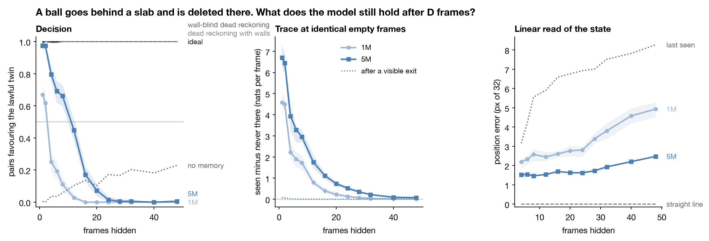
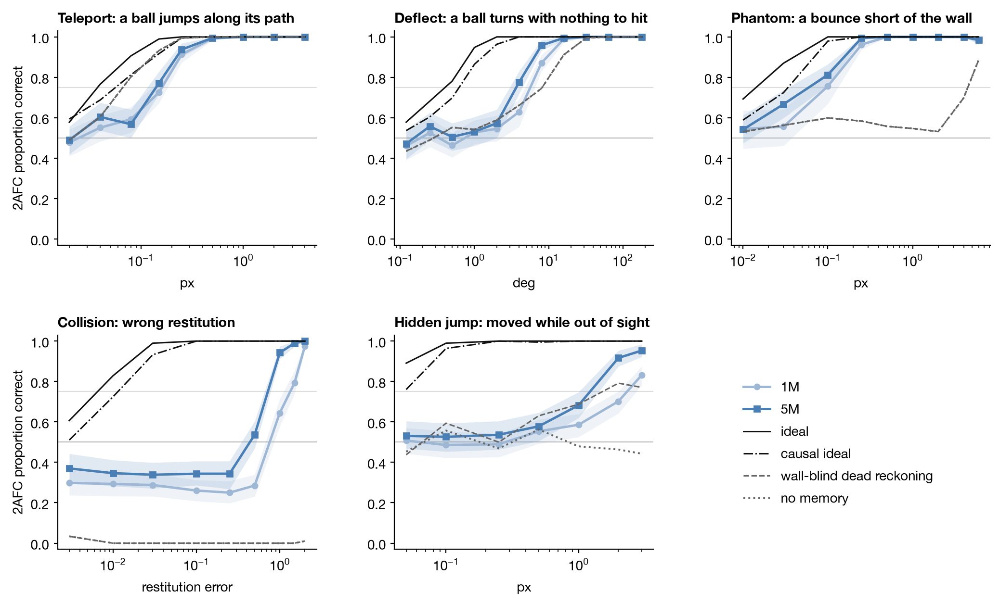

# Surprise Meter

A small world model, trained from scratch on a laptop on nothing but next-frame pixels, then measured the way a psychophysicist measures a person. It runs in your browser, guesses every frame before it sees it, and a meter shows how strange each frame was. Break the physics and watch the meter jump.

**[Open the demo](https://abhaymettu.github.io/surprise-meter/)**. No install, and nothing leaves your machine.



## What it found

Delete a ball while it is hidden behind a slab. Nothing comes out. Does the model notice?

Two versions of each clip go in, identical until the ball should reappear: one lawful, one with the ball gone. The model is right when the lawful one costs fewer nats. Scored until the lawful ball is 3 px out, its head stops getting this right after about 9 frames hidden, pooled over speeds and over four seeds trained after the analysis plan was frozen. Hidden time and speed are tied here, because a slab can only be so wide: below 0.4 px per frame the head is wrong even at 4 frames, from 0.4 to 0.6 it crosses at 9.6, and faster balls cross at 11.4.

That number depends on how the twins are scored. Over a reveal window each twin is scored under its own state, so the impossible twin's state has already seen empty frames. On the first frame where the twins differ, both are predicted from one state. There the head stays above chance to about 25 frames on a crossing, 15.0 to 30.2, while the 8-frame window model is below chance at every hidden time, so what carries the head there is memory and not the sight of an empty slab. What it keeps is mostly that a ball went in. The cosine between the head's predicted change and the sliver of ball that comes out falls from 0.57 at 4 frames hidden to 0.19 at 24, and against an observer told the exact lawful frame the head keeps about half that observer's sensitivity through 16 frames hidden and none from 32 frames on a crossing or 24 on a hidden bounce.

The state keeps where the ball is. A second linear read, fitted to the ball's position on hidden frames of other scenes from these families, follows the ball to the wall and back: on the return stroke the direction is right at least 98% of the time, with slope 0.84 to 1.01 against truth, at 16 and 28 frames hidden. Dead reckoning with walls is perfect in this world, so this says what the state holds and does not rank it against anything better.

The head uses those directions. Projecting out of the state, while the ball is hidden, the four directions a linear read of the ball leans on most takes the head at 8 frames hidden from 0.55 to 0.085 on a crossing and from 0.54 to 0.044 on a hidden bounce. Those four carry 0.3% of the state's variance, and four random directions carrying as much leave the head at 0.40 on both.

## A comparison that did not hold

I compared five readers that turn the same frozen state into a picture of the next frame, the head among them, each one change from the last, scored on the same twins under the world's pixel noise. Over the 3 px window, a ridge map told where hidden balls were when it was fitted kept the lawful twin ahead to 22.1 frames on a crossing and 27.1 on a hidden bounce, against the head's 8.8 and 9.1, and the analysis plan's criterion for that gap was met.

| Hidden frames where the lawful twin stops winning, 3 px window | Straight crossing | Hidden bounce |
|---|---|---|
| The model's head, with its own variance | 8.8 [7.5, 9.7] | 9.1 [below 6, 10.7] |
| The head's mean, at the world's noise | 9.8 [8.6, 10.9] | 11.8 [10.3, 15.7] |
| Ridge to the next frame | 9.8 [8.5, 10.8] | 12.1 [10.4, 16.0] |
| Ridge to visible pixels, drawn through slabs | 12.4 [11.0, 13.6] | 17.5 [11.8, 20.6] |
| Ridge to balls without slabs, told where they are when fitted | 22.1 [18.6, 25.2] | 27.1 [23.8, 29.6] |

It is not evidence of what the state holds. On the first frame where the twins differ, that map wins more often than the observer told the exact lawful frame, at every hidden time on a crossing: 0.78 against 0.66 at 4 frames. A reader at a fixed noise wins that decision exactly when it draws more than half the sliver's brightness onto the sliver, so a reader that draws the ball at its true brightness cannot beat that observer, and the map draws it 1.4 to 1.8 times too bright. It beats the head the same way. The head's predicted change lines up with the sliver better, a cosine of 0.57 against the map's 0.36 at 4 frames, but carries 0.85 of the sliver's brightness against the map's 1.46. The map to visible pixels, never told where hidden balls are, overshoots more the longer the ball was hidden, to 3.4 times at 48 frames, which is a glow at the slab's edge and not memory.

The ablation above needed a fair control. The first one took four directions chosen the same way from a map to slab cover, and they broke the head even more, which looked like the read's directions were not special. But those carry 7 to 9% of the state's variance against the read's 0.3%, and the head needs to know where slabs are too. Random directions matched to the read's variance are the fair control.

Both checks were added after the confirmatory results, following outside reviews, and are recorded in [the plan](docs/analysis-plan.md#changes-after-the-freeze).

## How it is measured

**The world.** Up to two balls and up to two slabs on 32 by 32 pixels, with pixel noise of 0.15. Every event is built as a twin: same scene, same noise, one law broken.

**The model.** A recurrent token state updated once per frame by a small transformer. There is no clock and no access to old pixels, so whatever it remembers is in the state. It trains on next-frame likelihood and nothing else.

**The observers.** Six reference observers see the same scenes and noise, from the observer told the lawful continuation down to one with no memory. The denominator for efficiency is the causal ideal, which knows the laws, radii and brightness but not where the balls started or how fast. Every observer scores a clip as the model does, by its likelihood under the observer's own prediction. The twins share their noise, so a rule that compared the two clips directly would always be right; "ideal" here means the best observer scored this way. An 8-frame attention window is the control with a known memory length.

Every 5M number comes from four seeds trained after [the analysis plan](docs/analysis-plan.md) was frozen. [`results/plan.md`](results/plan.md) is that plan's criteria evaluated by code. Brackets are 95% hierarchical bootstrap intervals over seeds and scenes; with four seeds they understate how far a new seed can move, as the set-aside seed below shows.

## Thresholds, against an ideal

At 75% correct, as magnitudes: teleport at 0.14 px, phantom bounce at 0.095 px, deflection at 3.6 degrees. The causal ideal reaches 0.065 px, 0.032 px and 0.63 degrees. Efficiency here is the squared ratio of 75% thresholds, against a causal ideal linearized around the true trajectory: 0.221 [0.168, 0.313], 0.117 [0.107, 0.179] and 0.030 [0.025, 0.042]. The causal ideal knows radius and brightness, so the real limit is a little weaker and these efficiencies are a little low.



The model's likelihood peaks at a restitution of 0.72 to 0.79 by seed, where the world's is 1. A unimodal head averaging over contact timing could produce the same, so this does not say it expects softer collisions.

## The meter in the demo

The meter is a table of held-out lawful frames: "1 in 9,300" means that share of frames from the training generator look at least this strange. At a promised 1 in 1000 it measures 0.0006 to 0.0011 through 1200 frames on 512 clips, far past the 64-frame clips the model trained on, and about 1.5 times the promise on frames where a ball comes out from behind a slab. Frames within a clip are dependent, so that is a descriptive check and not a coverage guarantee, and it stops applying the moment you drag a ball, which is the point.

## What else to keep in mind

- The design was not blind. Noise, clip length and crossing scenes were picked while watching vanish curves, and the seeds cannot remove that because they share the design. `5m-s0` was watched while the analysis was built, so it is set aside. It reads 11.0 and 12.5, above every confirmatory seed and outside both intervals, where the confirmatory seeds read 7.8 to 9.6 and 8.6 to 9.6.
- A longer reveal window lowers the head instead of raising it, because a twin decision needs the predicted ball above about half its contrast and frames with a ball cost more than empty ones.
- Size is not separated from training length. At 20000 steps 5M crosses at 8.8 frames on a vanish and 1M at 2.6, but 1M trained to 60000 steps reaches 9.4 [8.4, 10.2], and 5M stopped at 10000 stays at 2.9 [2.7, 3.1]. 20M at 20000 steps reads 9.8 [9.3, 10.4]. Those three are one seed each, so their intervals are over scenes only.
- The 8-frame window control is weak inside its window too. Its trace at one hidden frame is about a tenth of the recurrent 1M's, and on the first differing frame it is below chance even at 4 frames hidden, so as a null it rules out the sight of an empty slab carrying the head and not much more.
- Every training scene holds at least one ball, and a ball leaving the frame has no precedent in training.

## Rerun everything

```
python -m venv .venv && .venv/bin/pip install -e .
make results   # every table, figure and verdict, from the measurements in this repo. About two minutes
make test      # the instrument, checked without any trained model
make measure   # the measurements again from the published weights. Hours on an M-series Mac
make train     # everything from nothing. Days on one Mac, safe to stop and rerun
make demo      # the demo at http://127.0.0.1:8791
```

Trained on an M4 Pro with 24 GB. No job goes above 8 GB. A 5M seed takes about 1.5 hours and a 20M seed about 7.

## Where this sits

Scoring a learned model's surprise on matched possible and impossible clips goes back to IntPhys (Riochet and colleagues, [arXiv:1803.07616](https://arxiv.org/abs/1803.07616)) and PLATO (Piloto, Weinstein, Battaglia and Botvinick, Nature Human Behaviour, 2022), and Garrido and colleagues ([arXiv:2502.11831](https://arxiv.org/abs/2502.11831)) found it emerging in V-JEPA trained on natural video. LikePhys (Yuan, Pizzati, Pinto, Kunze, Laptev, Newman, Torr and De Martini, [arXiv:2510.11512](https://arxiv.org/abs/2510.11512)) scores matched valid and invalid videos by a likelihood proxy for video diffusion models, [N8python/physics-trainer](https://github.com/N8python/physics-trainer) scores twins on a small procedural world model at fixed magnitudes, and MultiEcho (Zhu and Zhang, [arXiv:2609.33347](https://arxiv.org/abs/2609.33347)) sweeps magnitude and visibility on frozen world models. Probes that find more than a model's output shows are a live question: Xie and Alanwar ([arXiv:2610.07355](https://arxiv.org/abs/2610.07355)) compare a probe on V-JEPA 2's encoder with its predictor for hidden objects, and Esmati, Nath and colleagues ([arXiv:2606.05328](https://arxiv.org/abs/2606.05328)) probe video diffusion models for physical plausibility. Projecting a probe's directions out and checking behaviour against random ones follows amnesic probing (Elazar, Ravfogel, Jacovi and Goldberg, [arXiv:2006.00995](https://arxiv.org/abs/2006.00995)), and Hewitt and Liang ([arXiv:1909.03368](https://arxiv.org/abs/1909.03368)) argue that a probe needs a control task. Their scenes, scores and scale differ from these, so nothing here says anything about their results. What this adds is 75% thresholds against observers that know the laws, for a small model trained from scratch in a world where every law is known, with seeds trained after the analysis plan was frozen. It also has a case, found after the confirmatory results, where an observer told the answer showed that, on the frame where both twins are judged from one state, a probe's lead over the model came from drawing the ball too bright.

MIT licensed. [`AGENTS.md`](AGENTS.md) maps the code.
